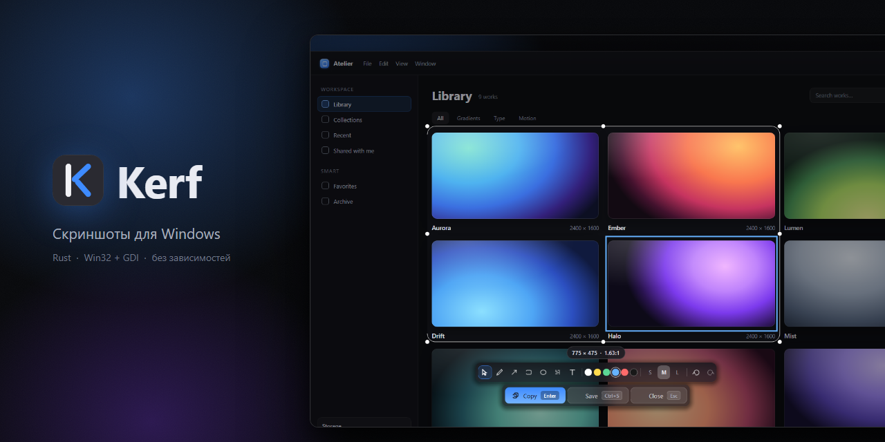
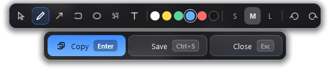
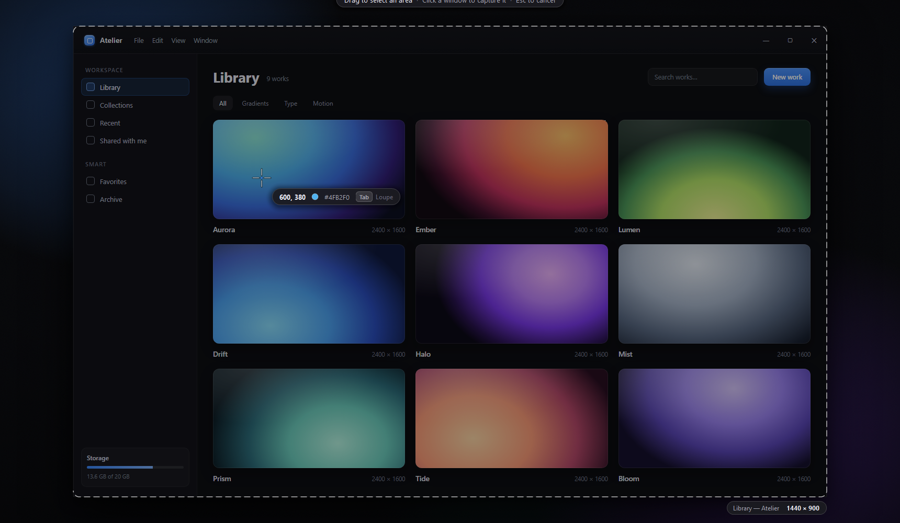
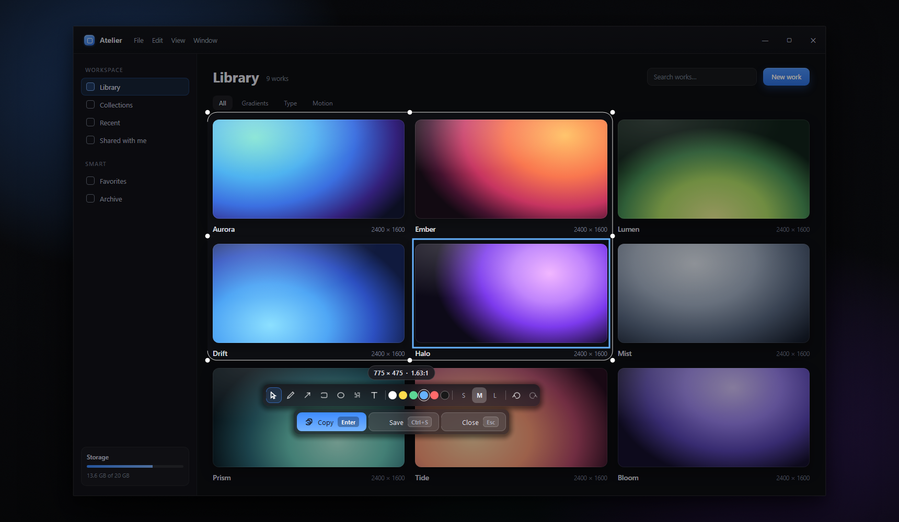
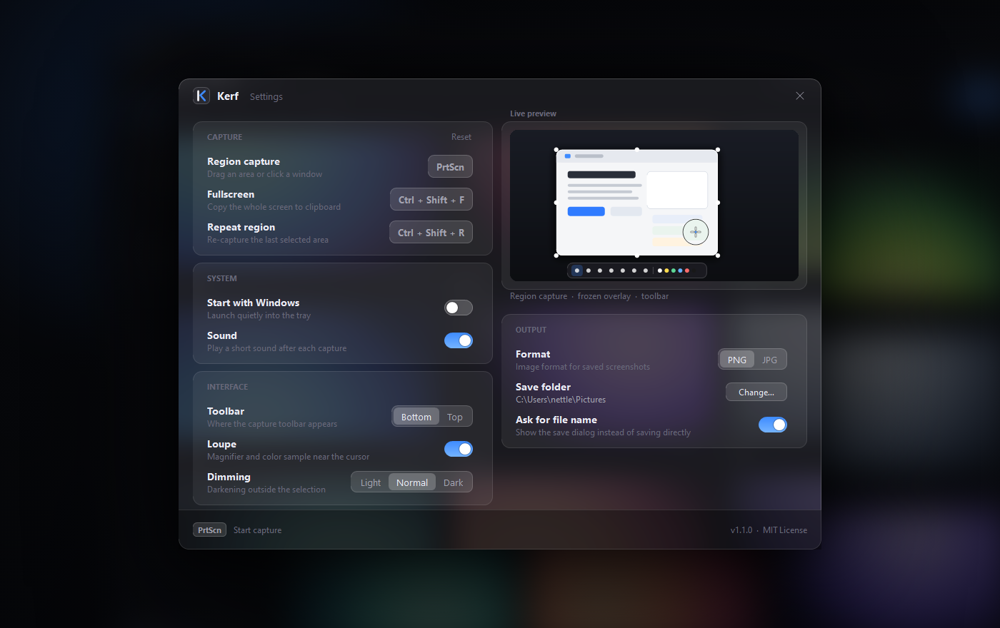
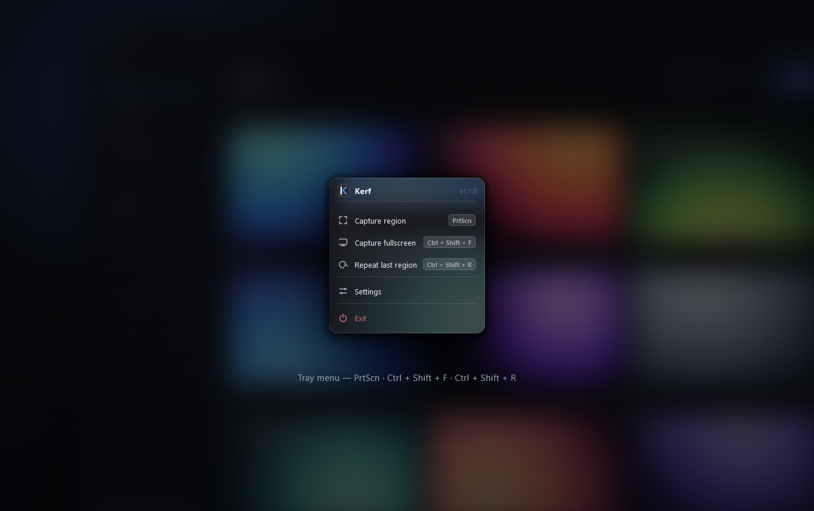

<h1 align="center">Kerf</h1>
<p align="center">A fast, minimalist screenshot tool for Windows 10/11.<br>Written in Rust. Precise cuts, nothing in the way.</p>

<p align="center">
  
  
  
</p>

<p align="center">
  
</p>

## Why Kerf

A kerf is the thin cut a saw leaves. The tool is built around the same idea: one clean, precise cut of your screen, as fast as possible.

- **Instant.** Press a hotkey and the screen freezes immediately. Low latency, near-zero idle CPU, small memory footprint.
- **Above everything.** The overlay covers the whole monitor and sits over any window, the taskbar and fullscreen apps.
- **Precise.** Pixel magnifier with coordinates and HEX color, window snapping, keyboard nudging with 1 px steps.
- **Minimal.** Flat dark interface with a single accent color. No clutter, no accounts, no telemetry.
- **Configurable.** Hotkeys, output and overlay behavior live in one readable JSON config and a native Settings window.

## Features

- Region, window and full-screen capture, repeat last region
- Window detection (dashed highlight on hover, click to capture)
- Live overlay: dimming, crosshair aim, HUD with size, coordinates and HEX color
- Pixel magnifier with HEX color picker (`Tab`)
- Annotations: pen, arrow, rectangle, ellipse, mosaic, text — with undo/redo
- Copy to clipboard and/or save as PNG / JPG
- Per-Monitor DPI Aware v2, multi-monitor aware
- Tray-only app, single instance, autostart option
- Custom dark tray menu, toast notifications, capture sound
- Single ~550 KB executable. Pure Win32 + GDI/GDI+ via `windows-sys` — no UI frameworks, no runtime dependencies</p>

<p align="center">
  
</p>

## Screenshots

<p align="center">
   
  
</p>

<p align="center">
   
  
</p>

## Install

Download the latest `Kerf.exe` from [Releases](https://github.com/nettlebyte/kerf/releases) and run it. Kerf lives in the system tray.

> The build is not code-signed yet, so Windows SmartScreen may warn on first launch. Click **More info → Run anyway**.

## Usage

| Action | Default |
| --- | --- |
| Start region capture | `PrintScreen` |
| Capture full screen | `Ctrl + Shift + F` |
| Repeat last region | `Ctrl + Shift + R` |
| Capture a window | click it under the overlay |
| Select the whole screen in overlay | `Ctrl + A` |
| Confirm / copy | `Enter` or `Ctrl + C` |
| Save | `Ctrl + S` |
| Cancel / reset selection | `Esc` / right-click |
| Nudge selection | arrow keys (`Shift` = 10 px) |
| Magnifier | `Tab` |
| Undo / redo annotation | `Ctrl + Z` / `Ctrl + Y` |

All hotkeys can be changed in Settings.

## Configuration

Settings live in `%APPDATA%\Kerf\config.json`, created on first run. Change everything from the Settings window in the tray menu — the file is rewritten by the app.

Main options:

- hotkeys per capture mode
- save folder and format (PNG / JPG)
- ask for file name instead of saving directly
- overlay: dim level (light / normal / dark), pixel magnifier on/off
- toolbar position: bottom or top
- autostart with Windows, capture sound

## Build from source

Requires Rust (stable, GNU or MSVC toolchain) and Windows 10/11.

```powershell
git clone https://github.com/nettlebyte/kerf.git
cd kerf
cargo build --release
```

The binary will be at `target\release\Kerf.exe`. The Cargo package is named `kerf`; the executable is `Kerf`.

For UI development there is a self-test mode that renders every window to PNG without interaction:

```powershell
.\target\release\Kerf.exe --selftest <folder>
```

End-to-end scenarios that drive the real overlay on a live screen live in `tests/e2e` (`run.ps1`, `aim.ps1`, `settings.ps1`, `annot.ps1`) — run them one at a time, they control the actual mouse.

## Known limitations

- Windows with capture protection (DRM video, windows using `SetWindowDisplayAffinity`) appear black. This is an OS restriction on GDI capture.
- Monitors with different DPI scaling in a multi-monitor setup may distort the captured image.

## Contributing

Issues and pull requests are welcome. Please keep changes focused and in line with the project's goals: performance, minimal design, convenience.

## License

[MIT](LICENSE) © 2026 nettlebyte
